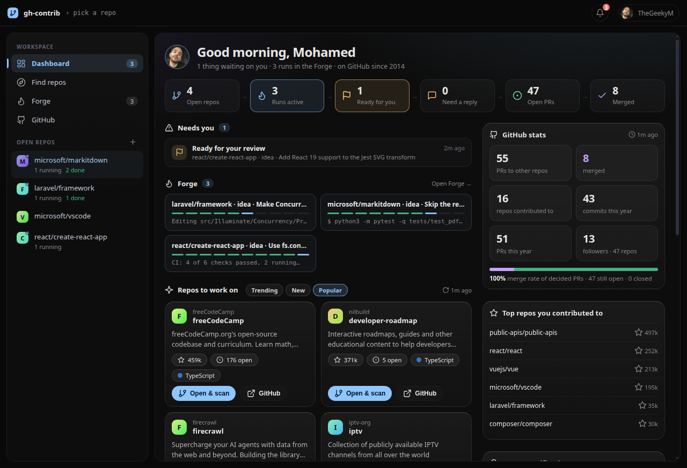
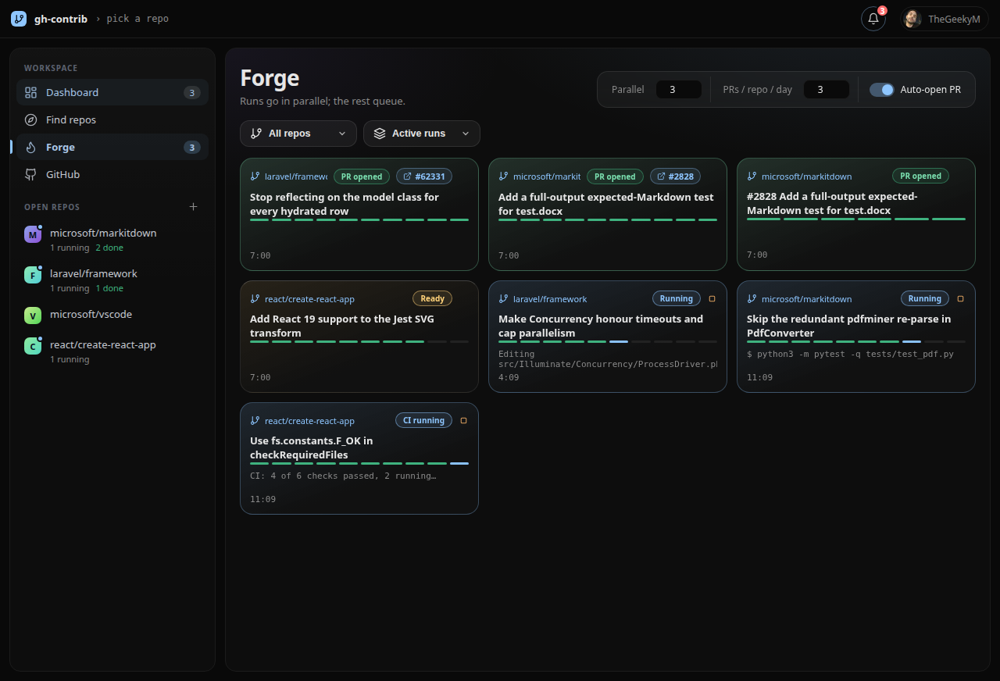
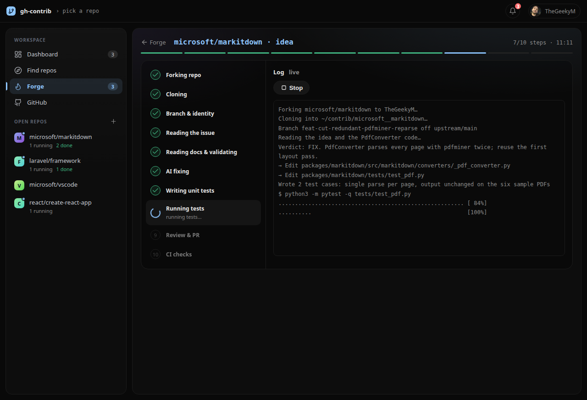
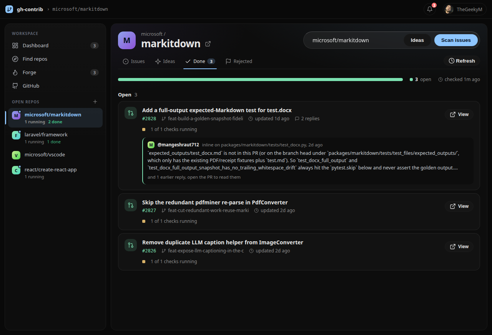
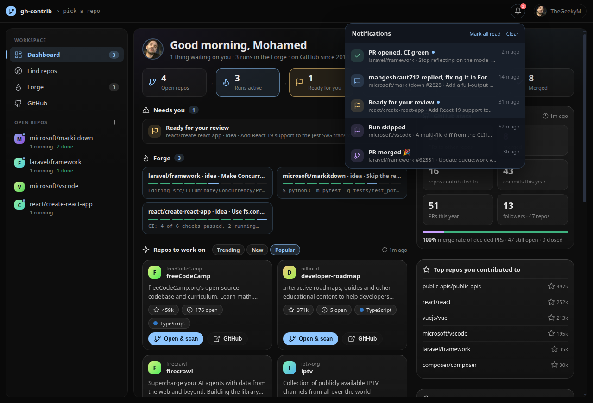
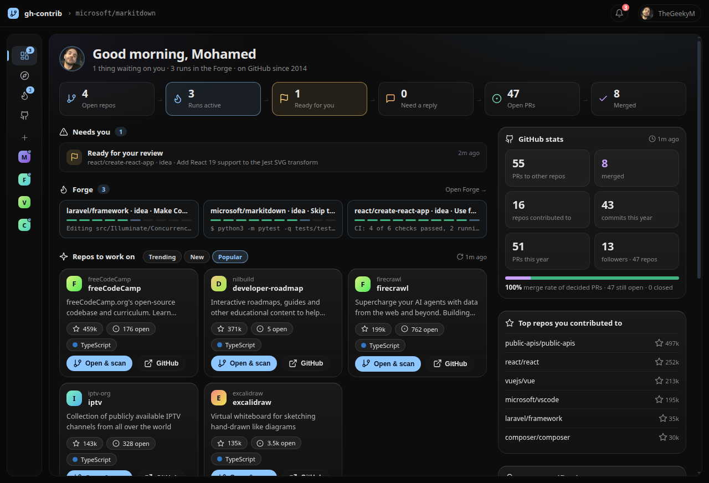

# gh-contrib

A desktop app (Electron) for contributing to popular open-source repos. It finds repos and issues worth your time, makes the change in parallel runs, opens the PR as you, and keeps going after it: CI fixes, reviewer replies and follow-up pushes.



## Features

**Dashboard** (the start page)
- **What needs you**: replies waiting on you, changes requested, failing CI, runs ready for review, failed or stuck runs. Each row opens the right place.
- **Forge at a glance**: active runs with their progress.
- **Repos to work on**: Trending (30 days), New (7 days) and Popular repos in your languages, with a refresh button. Repos whose docs ban AI-made PRs, repos that refuse your PRs, repos with issues turned off, and repos you already work on are left out.
- **GitHub stats**: PRs to other people's repos, merged count and merge rate, repos contributed to, commits and PRs this year, a contribution heatmap, your top repos and recent PRs.

**Find and scan**
- **Find repos**: search by name or text, or browse Popular / Trending / Newest by language and stars.
- **Scan issues**: open `good first issue` / `help wanted` issues with no assignee and no open PR.
- **Ideas**: the AI reads the project and proposes contributions grounded in the code. It skips what maintainers already declined and what you already did in your own PRs there.

**Forge** (parallel runs)



- Each run forks (or pushes directly if you have write access), branches, validates the issue, makes the change, writes unit tests and runs them (PHPUnit/Pest, Jest/Vitest, pytest). Real failures get up to two AI repair rounds.
- With **Auto-open PR** on, it opens the PR when tests pass, or as a draft when they cannot run on your machine, then watches CI: flaky jobs are re-run, real failures are fixed and pushed until it is green.
- **Hands-free**: interrupted runs continue when the app opens; runs whose tests still fail after repairs are skipped (nothing is published); repos that refuse your PRs are detected and skipped.
- Every run can be stopped, resumed from the step it reached, or reviewed by hand: diff, tests, PR text.



**After the PR**
- Each repo has a **Done** tab with your PRs, CI status and the latest replies.
- A new reviewer reply is sent to Forge automatically: it applies the fix, runs the tests, pushes and posts a reply on the PR. Replies that promise future work or carry AI traces are held back for you.



**Notifications**
- A bell with an unread count, toasts inside the app, and desktop notifications when the window is in the background.
- You hear about runs that finish, fail, get skipped or go quiet for 15 minutes, and about PR replies, merges, closes, failing CI and requested changes. Clicking one takes you there.



**Guard rails**
- Commits and PRs are made with plain `git` and `gh` as you. No AI or co-author traces are allowed in commits, PR text or replies.
- A per-repo cap on PRs per 24 hours (3 by default).
- Repos whose docs mention AI policies are hidden; security findings are never filed publicly (the app opens the repo's private advisory page).
- Agreeing to a CLA is never automated.

The sidebar can be resized by dragging its edge, or collapsed to icons:



## Install

Download the latest build from [Releases](https://github.com/TheGeekyM/gh-contrib/releases) (Linux x64):

- **AppImage**: `chmod +x gh-contrib-*.AppImage && ./gh-contrib-*.AppImage`
- **Debian/Ubuntu**: `sudo apt install ./gh-contrib-*.deb`

## Requirements

- [`gh`](https://cli.github.com) logged in (`gh auth login`)
- [`claude`](https://claude.com/claude-code) CLI logged in (the AI brain)
- `git`; Node 20+ to run from source

## Run from source

```
npm install
npm start
```

If `gh` returns HTTP 401 inside the app on Linux, launch with your session bus so it can read the keyring: `DBUS_SESSION_BUS_ADDRESS=unix:path=/run/user/$(id -u)/bus npm start`.

`npm test` runs the guard checks. `npm run dist` builds the AppImage and .deb into `dist/`.

Clones and worktrees live in `~/contrib`.

Many projects restrict or require disclosure of AI-assisted contributions. Read each repo's CONTRIBUTING and AI policy, and keep an eye on what the app sends in your name.
